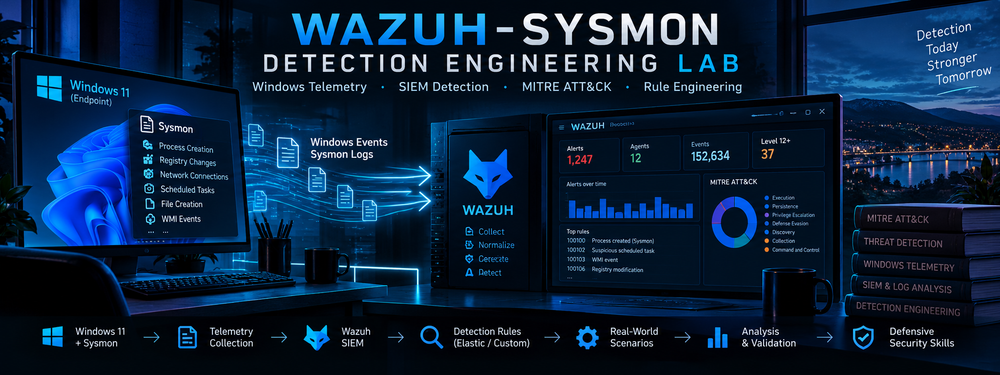

# Wazuh-Sysmon Detection Engineering Lab

A hands-on defensive security lab focused on **Windows endpoint telemetry, SIEM detection engineering, MITRE ATT&CK mapping, rule development, alert validation, tuning, and troubleshooting** using **Wazuh** and **Sysmon**.

The project was built to go beyond simply generating alerts. The objective was to understand the complete detection pipeline:

```text
Windows activity
    ↓
Sysmon / Windows Event Logs
    ↓
Wazuh Agent
    ↓
Wazuh Manager
    ↓
Native / Custom Detection Rules
    ↓
MITRE ATT&CK Mapping
    ↓
Threat Hunting & Investigation
```

---

## Project Goals

This lab was designed to practice a realistic detection-engineering workflow:

- collect and validate endpoint telemetry;
- identify useful Windows and Sysmon event sources;
- evaluate existing Wazuh detection coverage;
- develop custom detection rules where coverage was missing;
- map detections to MITRE ATT&CK;
- validate rules against real endpoint activity;
- tune noisy detections;
- troubleshoot discrepancies between offline testing and live processing;
- separate validated production rules from experimental detections;
- document both successful and unsuccessful scenarios.

---

## Lab Architecture

The environment contains:

- **Windows 11 endpoint** - monitored workstation
- **Sysmon** - endpoint telemetry
- **Wazuh Agent 4.8.2**
- **Wazuh Manager 4.8.2**
- **Wazuh Indexer**
- **Wazuh Dashboard**
- **VMware Workstation NAT network**

```text
+-----------------------------+
|       WIN11-ENDPOINT        |
|                             |
| Windows 11                  |
| Sysmon                      |
| Windows Security Logs       |
| TaskScheduler Logs          |
| Defender Operational Logs   |
| Wazuh Agent                 |
+-------------+---------------+
              |
              v
+-----------------------------+
|        Wazuh Manager        |
|                             |
| Native Rules                |
| Custom Rules                |
| MITRE ATT&CK Mapping        |
| wazuh-logtest               |
+-------------+---------------+
              |
              v
+-----------------------------+
|        Wazuh Indexer        |
+-------------+---------------+
              |
              v
+-----------------------------+
|        Wazuh Dashboard      |
|                             |
| Threat Hunting              |
| Alert Investigation         |
+-----------------------------+
```

More details are available in:

[`architecture/architecture.md`](architecture/architecture.md)

---

## Detection Scenarios

Ten controlled scenarios were evaluated.

| # | Scenario | Detection Type | Rule | Result |
|---|---|---|---|---|
| 01 | Encoded PowerShell | Native Wazuh | `92057` | ✅ Live detection |
| 02 | Local Administrators group modification | Native Wazuh | `60154` | ✅ Live detection |
| 03 | WScript spawning PowerShell | Custom | `100100` | ✅ Live detection |
| 04 | Scheduled Task persistence | Experimental | `100101` | ⚠️ Offline match / live limitation |
| 05 | Hidden PowerShell | Custom | `100102` | ✅ Live detection |
| 06 | Defender Tamper Protection | Experimental | `100103` | ⚠️ Event collected / no live custom alert |
| 07 | PowerShell web download command | Custom | `100104` | ✅ Live detection |
| 08 | Registry Run Key persistence | Experimental | `100105` | ⚠️ Telemetry observed / tuning required |
| 09 | MSHTA with remote URL | Custom | `100106` | ✅ Live detection |
| 10 | Certutil remote download attempt | Experimental | `100107` | 🛡️ Blocked by endpoint protection |

Full scenario documentation:

[`scenarios/`](scenarios/)

Detection summary:

[`docs/detection-matrix.md`](docs/detection-matrix.md)

---

## Visual Evidence

Below are representative screenshots from the lab. Full evidence is available in the individual scenario documentation.

### Encoded PowerShell - Native Wazuh Rule 92057


---

### WScript → PowerShell - Custom Rule 100100


---

### Hidden PowerShell - Custom Rule 100102


---

### PowerShell Web Download - Custom Rule 100104


---

### MSHTA with Remote URL - Custom Rule 100106


---

### Microsoft Defender Tamper Protection - Event ID 5013


For complete telemetry, rule logic, test commands, and troubleshooting notes, see the [`scenarios/`](scenarios/) directory.

---

## Production Custom Rules

The following custom detections were successfully validated in the live Wazuh pipeline:

### Rule 100100 - PowerShell launched by Windows Script Host

Detects:

```text
wscript.exe
    ↓
powershell.exe
```

MITRE ATT&CK:

- `T1059.001` - PowerShell
- `T1059.005` - Visual Basic

---

### Rule 100102 - Hidden PowerShell

Detects PowerShell launched with arguments such as:

```text
-WindowStyle Hidden
```

MITRE ATT&CK:

- `T1059.001` - PowerShell
- `T1564.003` - Hidden Window

---

### Rule 100104 - PowerShell Web Download Command

Detects PowerShell processes launched with commands such as:

```text
Invoke-WebRequest
iwr
wget
curl
```

MITRE ATT&CK:

- `T1059.001` - PowerShell
- `T1105` - Ingress Tool Transfer

---

### Rule 100106 - MSHTA with Remote URL

Detects:

```text
mshta.exe https://...
```

MITRE ATT&CK:

- `T1218.005` - Mshta

---

## Experimental Rules

Not every detection was promoted to the production ruleset.

Experimental detections are preserved separately to document:

- live-processing limitations;
- excessive alert noise;
- endpoint prevention;
- tuning requirements;
- differences between `wazuh-logtest` and the live pipeline.

See:

[`rules/experimental/experimental_rules.xml`](rules/experimental/experimental_rules.xml)

and:

[`rules/experimental/README.md`](rules/experimental/README.md)

---

## Telemetry Sources

The lab used several Windows telemetry sources.

### Sysmon

Key events included:

- **Event ID 1** - Process creation
- **Event ID 13** - Registry value set
- **Event ID 22** - DNS query

### Windows Security

Used for account and local group activity.

Example:

- **Event ID 4732** - Member added to a security-enabled local group

### Task Scheduler Operational

Used to inspect scheduled-task registration and execution.

Example:

- **Event ID 106** - Scheduled task registered

### Microsoft Defender Operational

Used to observe Defender configuration protection.

Example:

- **Event ID 5013** - Tamper Protection blocked a configuration change

---

## Wazuh Agent Event Channels

Additional Windows Event Channels were added to the Wazuh Agent configuration:

```xml
<localfile>
  <location>Microsoft-Windows-Sysmon/Operational</location>
  <log_format>eventchannel</log_format>
</localfile>

<localfile>
  <location>Microsoft-Windows-TaskScheduler/Operational</location>
  <log_format>eventchannel</log_format>
</localfile>

<localfile>
  <location>Microsoft-Windows-Windows Defender/Operational</location>
  <log_format>eventchannel</log_format>
</localfile>
```

---

## Detection Engineering Workflow

The project followed this workflow:

```text
Define behavior
      ↓
Map to MITRE ATT&CK
      ↓
Identify telemetry source
      ↓
Generate controlled activity
      ↓
Validate endpoint event
      ↓
Confirm Wazuh collection
      ↓
Check native coverage
      ↓
Develop custom rule if needed
      ↓
Validate with wazuh-logtest
      ↓
Test in live pipeline
      ↓
Review alert quality
      ↓
Tune / troubleshoot
      ↓
Production or Experimental
```

---

## Key Lessons

Some of the most important lessons from the lab were:

- native SIEM coverage should be checked before creating duplicate rules;
- parent-child process relationships provide strong behavioral context;
- command-line telemetry is highly valuable for Windows detections;
- a rule that triggers is not automatically a useful rule;
- `wazuh-logtest` success does not guarantee live alert generation;
- telemetry collection must be validated before debugging detection logic;
- endpoint prevention can stop an action before expected detection telemetry exists;
- unsuccessful scenarios still provide useful engineering evidence.

More details:

[`docs/lessons-learned.md`](docs/lessons-learned.md)

---

## Repository Structure

```text
Wazuh-Sysmon-Detection-Engineering-Lab/
│
├── README.md
│
├── architecture/
│   └── architecture.md
│
├── configs/
│   ├── wazuh-agent-ossec.conf
│   └── sysmon-config-notes.md
│
├── docs/
│   ├── detection-matrix.md
│   └── lessons-learned.md
│
├── rules/
│   ├── production/
│   │   └── local_rules.xml
│   │
│   └── experimental/
│       ├── experimental_rules.xml
│       └── README.md
│
├── scenarios/
│   ├── 01-encoded-powershell.md
│   ├── 02-local-admin-group-change.md
│   ├── 03-wscript-powershell.md
│   ├── 04-scheduled-task-persistence.md
│   ├── 05-hidden-powershell.md
│   ├── 06-defender-tamper-protection.md
│   ├── 07-powershell-web-download.md
│   ├── 08-registry-run-key.md
│   ├── 09-mshta-remote-url.md
│   └── 10-certutil-download-attempt.md
│
└── screenshots/
    ├── scenario-01/
    ├── scenario-02/
    ├── scenario-03/
    ├── scenario-04/
    ├── scenario-05/
    ├── scenario-06/
    ├── scenario-07/
    ├── scenario-08/
    ├── scenario-09/
    └── scenario-10/
```

---

## Tools & Technologies

- Windows 11
- Wazuh 4.8.2
- Sysmon
- PowerShell
- Windows Event Viewer
- VMware Workstation
- MITRE ATT&CK
- XML / Wazuh Rules
- `wazuh-logtest`

---

## Scope and Safety

All scenarios were executed in an isolated virtual lab using controlled, non-destructive test activity.

No production systems were targeted.

The purpose of this repository is defensive security research, detection engineering, telemetry validation, and SIEM rule development.

---

## Author

**Aaron Abavi**

Cybersecurity master's student focused on:

- defensive security;
- vulnerability management;
- SIEM and detection;
- system security;
- application security.
