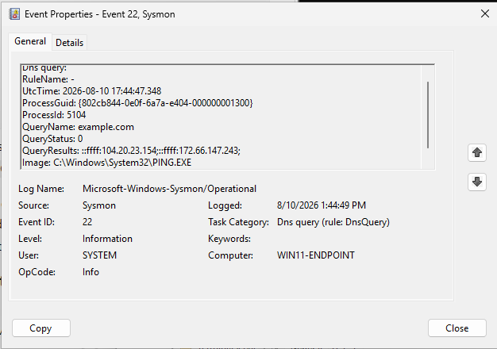
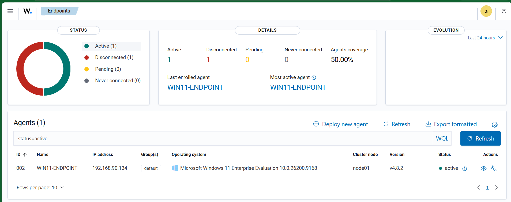

# Sysmon Configuration Notes

## Overview

Sysmon was used as the primary Windows endpoint telemetry source for custom
process- and registry-based detections in this lab.

The configuration used during the project was based on the public
SwiftOnSecurity Sysmon configuration and was stored locally on the endpoint as:

```text
C:\Tools\Sysmon\sysmonconfig-export.xml
```

Sysmon was installed from:

```text
C:\Tools\Sysmon\
```

using:

```powershell
.\Sysmon64.exe -accepteula -i .\sysmonconfig-export.xml
```

The resulting Windows service was:

```text
Sysmon64
```

and its status was validated as `Running`.

---

## Event Log

Sysmon events were collected from:

```text
Microsoft-Windows-Sysmon/Operational
```

The corresponding Wazuh Agent configuration block was:

```xml
<localfile>
  <location>Microsoft-Windows-Sysmon/Operational</location>
  <log_format>eventchannel</log_format>
</localfile>
```

---

## Key Sysmon Events Used

### Event ID 1 — Process Create

This was the most important event source for the project.

Useful fields included:

- `Image`
- `CommandLine`
- `ParentImage`
- `ParentCommandLine`
- `User`
- `ProcessId`
- `ParentProcessId`
- process hashes

It supported detections such as:

- WScript spawning PowerShell;
- hidden PowerShell;
- PowerShell web-download commands;
- MSHTA with a remote URL;
- Certutil execution analysis.

---

### Event ID 13 — Registry Value Set

Used during the Registry Run Key persistence scenario.

Useful fields included:

- `Image`
- `TargetObject`
- `Details`
- `User`

The event confirmed creation of a value under:

```text
HKCU\Software\Microsoft\Windows\CurrentVersion\Run
```

---

### Event ID 22 — DNS Query

Used during initial telemetry validation.

A DNS query for a benign domain such as:

```text
example.com
```

was successfully observed and confirmed that Sysmon DNS telemetry was reaching
the Wazuh collection pipeline.

---

## Validation Method

Sysmon telemetry was validated in multiple stages:

1. Generate benign test activity on the Windows endpoint.
2. Confirm the event in Windows Event Viewer or PowerShell.
3. Confirm collection by the Wazuh Agent.
4. Inspect Wazuh archives when troubleshooting was required.
5. Validate detection behavior in Wazuh Threat Hunting.

Example endpoint-side checks included:

```powershell
Get-WinEvent -LogName "Microsoft-Windows-Sysmon/Operational" -MaxEvents 20
```

For a specific Event ID:

```powershell
Get-WinEvent `
  -FilterHashtable @{
    LogName = "Microsoft-Windows-Sysmon/Operational"
    Id      = 1
  } `
  -MaxEvents 20
```

---

## Detection Engineering Notes

### Process creation context matters

A binary name alone is rarely sufficient for a high-quality detection.

For example:

```text
powershell.exe
```

is common.

However:

```text
wscript.exe -> powershell.exe
```

or:

```text
powershell.exe -WindowStyle Hidden
```

provides more useful behavioral context.

---

### Command-line visibility was essential

Several custom rules depended on the command line captured by Sysmon Event ID 1.

Examples included:

```text
Invoke-WebRequest
-WindowStyle Hidden
https://example.com
```

This allowed rules to focus on process behavior instead of process names alone.

---

### Event generation and process creation are not the same thing

One important observation occurred during the PowerShell web-download scenario.

Running:

```powershell
Invoke-WebRequest ...
```

inside an already-running PowerShell session did not create a new
Sysmon Event ID 1 containing that command.

Launching a new process did:

```powershell
powershell.exe -NoProfile -Command "Invoke-WebRequest 'https://example.com' -UseBasicParsing | Out-Null"
```

This distinction was important when validating process-creation detections.

---

## Configuration Scope

The project does not redistribute the complete third-party Sysmon configuration.

Instead, this repository documents:

- which Sysmon configuration approach was used;
- how Sysmon was installed;
- which event IDs were relevant;
- how those events were consumed by Wazuh;
- how telemetry was validated during detection engineering.

Users should review and adapt any Sysmon configuration before deploying it in
their own environment.


---

## Visual Validation

### Sysmon DNS Event ID 22



The screenshot shows a successful DNS query event for `example.com`, confirming that Sysmon DNS telemetry was active.

### Active Wazuh Endpoint



The Wazuh dashboard shows `WIN11-ENDPOINT` as an active agent.
