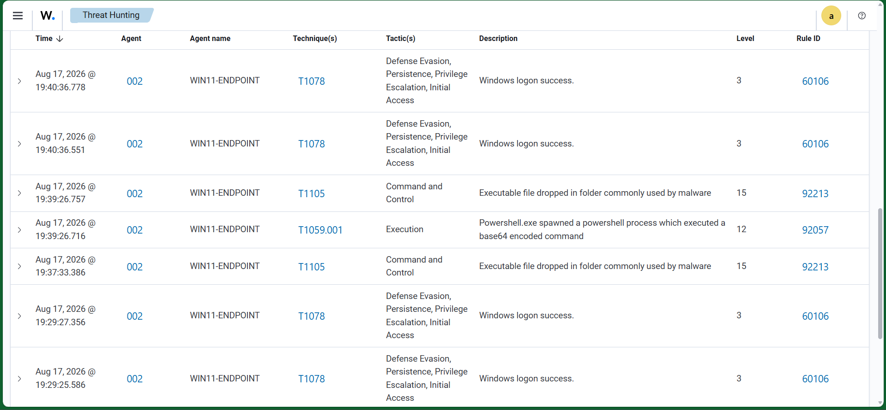

# Scenario 01 — Encoded PowerShell

## Objective

Validate whether Wazuh natively detects PowerShell launched with an encoded command.

## Data Source

- Sysmon Event ID 1 — Process creation
- Wazuh Windows/Sysmon ruleset

## Test

A harmless PowerShell command was executed through the `-EncodedCommand` parameter.

```powershell
powershell.exe -EncodedCommand VwByAGkAdABlAC0ATwB1AHQAcAB1AHQAIAAnAEQAZQB0AGUAYwB0AGkAbwBuAEwAYQBiAFQAZQBzAHQAJwA=
```

The decoded command was:

```powershell
Write-Output 'DetectionLabTest'
```

## Detection

Wazuh detected the behavior using a native rule.

- **Wazuh Rule ID:** `92057`
- **Severity Level:** `12`
- **Description:** PowerShell spawned a PowerShell process which executed a Base64 encoded command
- **MITRE ATT&CK:** `T1059.001` — PowerShell

## Result

✅ **Detected live using a native Wazuh rule.**

No custom rule was retained because native coverage was already strong and creating a duplicate rule would add unnecessary noise.

## Detection Engineering Takeaway

This scenario reinforced the importance of checking existing SIEM coverage before creating a new rule.

## Evidence



The screenshot shows the live Wazuh alert for encoded PowerShell execution, including Rule ID `92057`, severity level `12`, and MITRE ATT&CK technique `T1059.001`.
