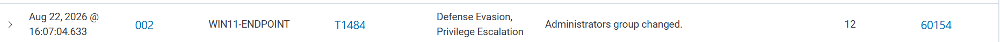
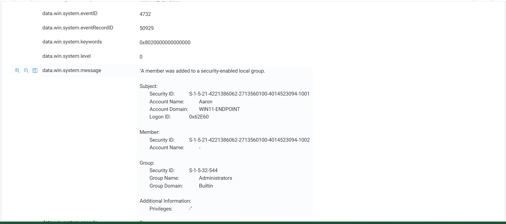

# Scenario 02 — Local Administrators Group Modification

## Objective

Validate whether Wazuh detects the addition of a local user to the Windows `Administrators` group.

## Data Source

- Windows Security Event Log
- Windows Event ID `4732`

## Test

A temporary local account was created and then added to the local Administrators group.

```powershell
$password = Read-Host "Temporary password" -AsSecureString
New-LocalUser -Name "labadmin-test" -Password $password -Description "Detection Engineering Lab test account"

Add-LocalGroupMember -Group "Administrators" -Member "labadmin-test"
```

## Detection

Wazuh generated a native alert.

- **Windows Event ID:** `4732`
- **Wazuh Rule ID:** `60154`
- **Severity Level:** `12`
- **Description:** `Administrators group changed.`

## Result

✅ **Detected live using a native Wazuh rule.**

## Cleanup

```powershell
Remove-LocalGroupMember -Group "Administrators" -Member "labadmin-test"
Remove-LocalUser -Name "labadmin-test"
```

## Detection Engineering Takeaway

Native Windows Security events can provide strong identity and privilege-change telemetry without requiring a custom rule.

## Evidence





The first screenshot shows the live Wazuh alert generated by Rule ID `60154`. The second shows Windows Security Event ID `4732`, including the affected `Administrators` group and the account context.
