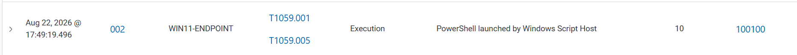
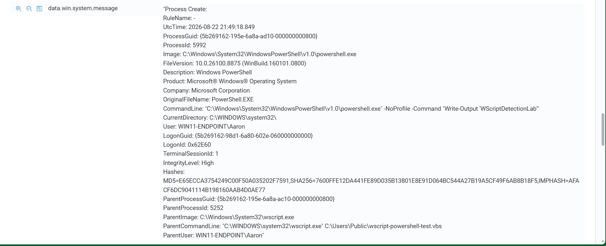

# Scenario 03 - PowerShell Spawned by Windows Script Host

## Objective

Detect PowerShell launched by `wscript.exe`, an unusual parent-child process relationship that can be associated with script-based execution.

## Data Source

- Sysmon Event ID 1 - Process creation

## Custom Rule

- **Rule ID:** `100100`
- **Severity Level:** `10`
- **MITRE ATT&CK:**
  - `T1059.001` - PowerShell
  - `T1059.005` - Visual Basic

```xml
<rule id="100100" level="10">
  <if_group>sysmon_event1</if_group>
  <field name="win.eventdata.image" type="pcre2">(?i)\\powershell\.exe$</field>
  <field name="win.eventdata.parentImage" type="pcre2">(?i)\\wscript\.exe$</field>
  <description>PowerShell launched by Windows Script Host</description>
  <mitre>
    <id>T1059.001</id>
    <id>T1059.005</id>
  </mitre>
  <group>powershell,script_execution,suspicious_execution,</group>
</rule>
```

## Test

A harmless VBS file was created:

```vbscript
Set shell = CreateObject("WScript.Shell")
shell.Run "powershell.exe -NoProfile -Command ""Write-Output 'WScriptDetectionLab'""", 1, True
```

Then executed with:

```powershell
wscript.exe C:\Users\Public\wscript-powershell-test.vbs
```

## Result

 **Custom rule detected live in Wazuh Threat Hunting.**

The alert showed:

- `wscript.exe` as the parent process
- `powershell.exe` as the child process
- the PowerShell command line
- MITRE mappings for PowerShell and Visual Basic

## Cleanup

```powershell
Remove-Item "C:\Users\Public\wscript-powershell-test.vbs"
```

## Detection Engineering Takeaway

Parent-child process relationships provide more useful behavioral context than executable names alone.

## Evidence





The alert confirms Rule ID `100100` triggered live. The detailed Sysmon event shows `wscript.exe` as the parent process and `powershell.exe` as the child process.
