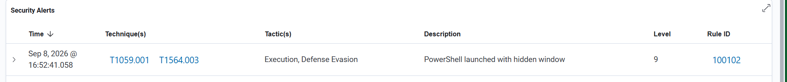
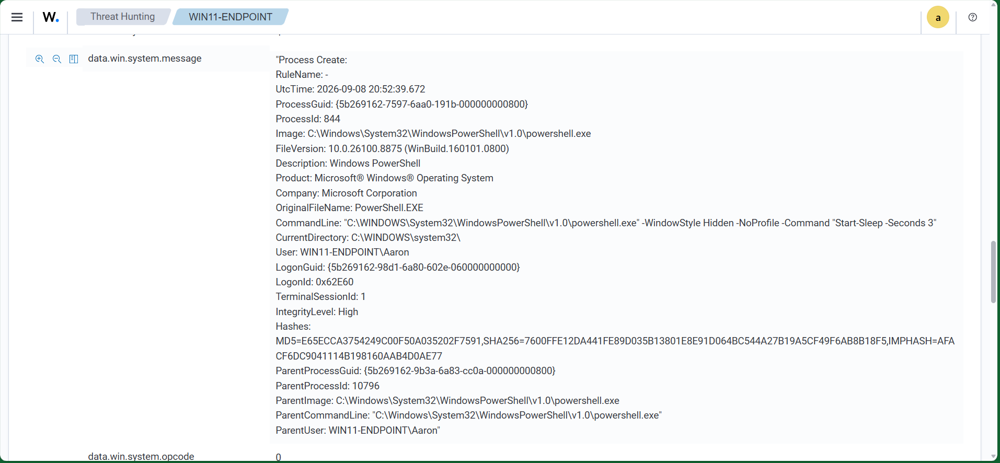

# Scenario 05 — Hidden PowerShell Window

## Objective

Detect PowerShell launched with a hidden window.

## Data Source

- Sysmon Event ID 1 — Process creation

## Custom Rule

- **Rule ID:** `100102`
- **Severity Level:** `9`
- **MITRE ATT&CK:**
  - `T1059.001` — PowerShell
  - `T1564.003` — Hidden Window

```xml
<rule id="100102" level="9">
  <if_group>sysmon_event1</if_group>
  <field name="win.eventdata.image" type="pcre2">(?i)\\powershell\.exe$</field>
  <field name="win.eventdata.commandLine" type="pcre2">(?i)(-WindowStyle\s+Hidden|-w\s+Hidden)</field>
  <description>PowerShell launched with hidden window</description>
  <mitre>
    <id>T1059.001</id>
    <id>T1564.003</id>
  </mitre>
  <group>powershell,hidden_window,suspicious_execution,</group>
</rule>
```

## Test

```powershell
powershell.exe -WindowStyle Hidden -NoProfile -Command "Start-Sleep -Seconds 3"
```

## Result

✅ **Custom rule detected live.**

## Detection Engineering Takeaway

Command-line arguments significantly improve detection fidelity.

## Evidence





The Wazuh alert shows Rule ID `100102`, severity level `9`, and MITRE ATT&CK mappings `T1059.001` and `T1564.003`. The detailed event confirms the `-WindowStyle Hidden` command-line argument.
