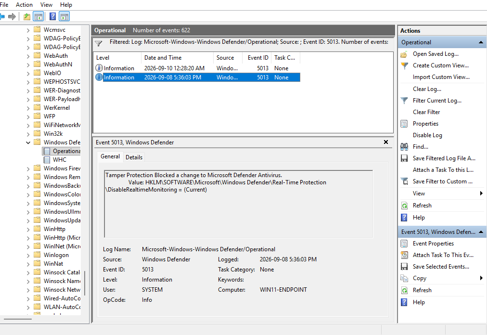
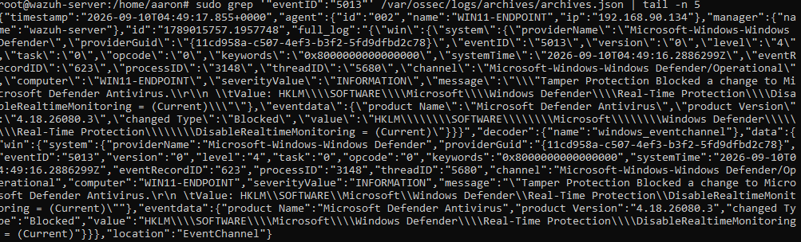

# Scenario 06 - Microsoft Defender Tamper Protection

## Objective

Observe and detect a blocked attempt to modify Microsoft Defender real-time protection.

## Data Source

- `Microsoft-Windows-Windows Defender/Operational`
- Windows Defender Event ID `5013`

## Test

```powershell
Get-MpComputerStatus | Select-Object IsTamperProtected,RealTimeProtectionEnabled
Set-MpPreference -DisableRealtimeMonitoring $true
```

Tamper Protection prevented the change.

## Observed Event

Windows Defender generated Event ID `5013`:

> Tamper Protection Blocked a change to Microsoft Defender Antivirus.

## Experimental Rule

- **Rule ID:** `100103`
- **Severity Level:** `10`
- **MITRE ATT&CK:** `T1562.001` - Impair Defenses

## Result

 **Event ID 5013 was successfully collected by Wazuh, but the custom rule did not generate a live alert.**

The rule was retained as experimental.

## Detection Engineering Takeaway

Preventive controls can stop an action while still producing valuable security telemetry.

## Evidence





The Event Viewer screenshot confirms Microsoft Defender Tamper Protection generated Event ID `5013`. The Wazuh archive screenshot confirms the same event was successfully collected by Wazuh even though custom Rule ID `100103` did not generate a live dashboard alert.
