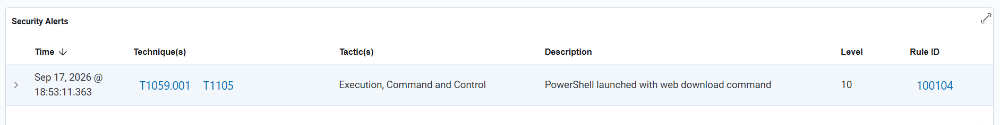
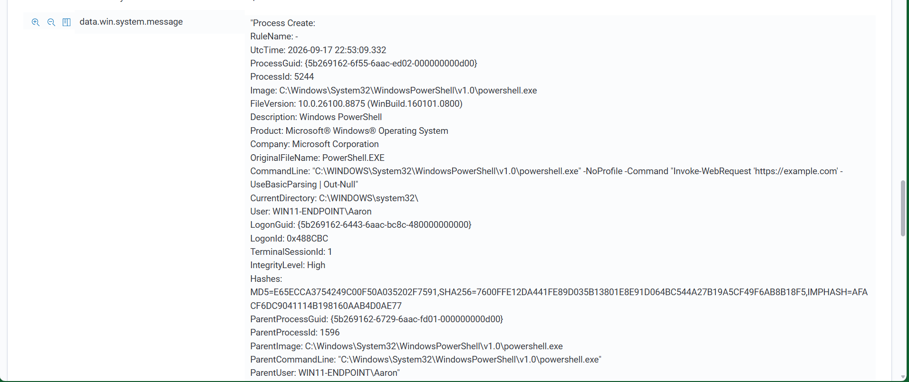

# Scenario 07 — PowerShell Web Download Command

## Objective

Detect a newly created PowerShell process containing a web-download command.

## Data Source

- Sysmon Event ID 1 — Process creation

## Custom Rule

- **Rule ID:** `100104`
- **Severity Level:** `10`
- **MITRE ATT&CK:**
  - `T1059.001` — PowerShell
  - `T1105` — Ingress Tool Transfer

```xml
<rule id="100104" level="10">
  <if_group>sysmon_event1</if_group>
  <field name="win.eventdata.image" type="pcre2">(?i)\\powershell\.exe$</field>
  <field name="win.eventdata.commandLine" type="pcre2">(?i)(Invoke-WebRequest|\biwr\b|\bwget\b|\bcurl\b)</field>
  <description>PowerShell launched with web download command</description>
  <mitre>
    <id>T1059.001</id>
    <id>T1105</id>
  </mitre>
  <group>powershell,network_activity,command_and_control,suspicious_execution,</group>
</rule>
```

## Test

```powershell
powershell.exe -NoProfile -Command "Invoke-WebRequest 'https://example.com' -UseBasicParsing | Out-Null"
```

## Result

✅ **Custom rule detected live.**

## Detection Engineering Takeaway

For process-creation detections, suspicious arguments must be present when the monitored process is created.

## Evidence





The Wazuh alert confirms Rule ID `100104` triggered live. The detailed Sysmon event shows the `Invoke-WebRequest` command in the PowerShell process command line.
