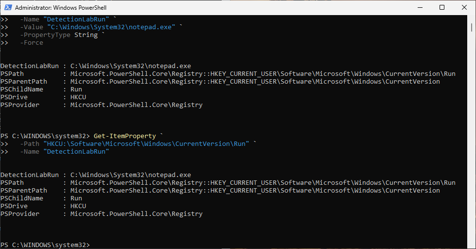
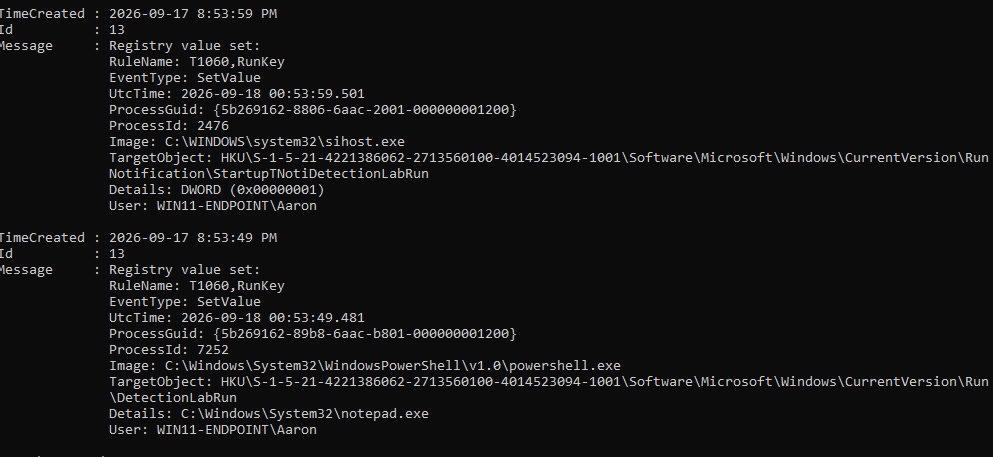

# Scenario 08 - Registry Run Key Persistence

## Objective

Detect persistence through a Windows Registry `Run` key.

## Data Source

- Sysmon Event ID 13 - Registry value set

## Test

```powershell
New-ItemProperty `
  -Path "HKCU:\Software\Microsoft\Windows\CurrentVersion\Run" `
  -Name "DetectionLabRun" `
  -Value "C:\Windows\System32\notepad.exe" `
  -PropertyType String `
  -Force
```

Sysmon successfully recorded the registry modification.

## Experimental Rule

- **Rule ID:** `100105`
- **Severity Level:** `10`
- **MITRE ATT&CK:** `T1547.001` - Registry Run Keys / Startup Folder

## Tuning

An early version was too broad and produced excessive noise. Additional process and path context was introduced.

## Result

 **Sysmon telemetry was observed, but the custom rule was not retained as a production live detection.**

## Detection Engineering Takeaway

A rule that generates alerts is not automatically useful. Signal-to-noise ratio and live-pipeline validation are essential.

## Cleanup

```powershell
Remove-ItemProperty `
  -Path "HKCU:\Software\Microsoft\Windows\CurrentVersion\Run" `
  -Name "DetectionLabRun" `
  -ErrorAction SilentlyContinue
```

## Evidence





The first screenshot confirms the `DetectionLabRun` value was created under the current user's `Run` key. The second shows Sysmon Event ID `13`, including the PowerShell process, registry target, value data, and user context.

The telemetry was successfully observed, but Rule ID `100105` was not retained as a production live detection.
