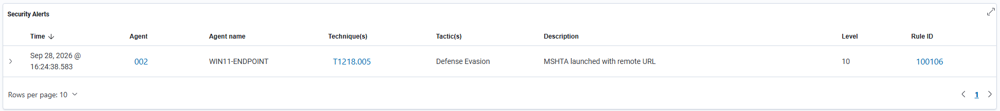
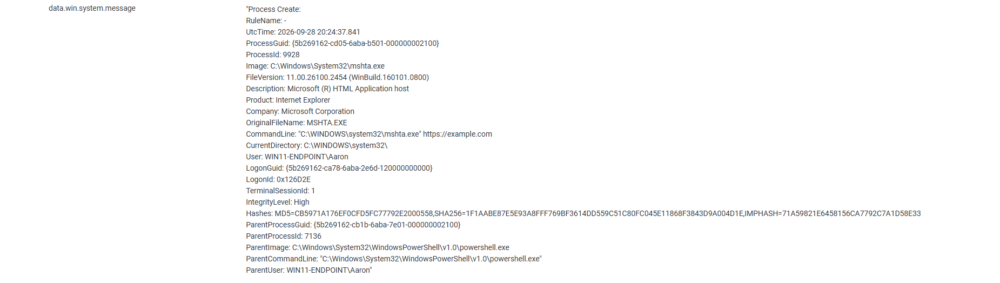

# Scenario 09 — MSHTA Launched with Remote URL

## Objective

Detect `mshta.exe` launched with an HTTP/HTTPS URL.

## Data Source

- Sysmon Event ID 1 — Process creation

## Custom Rule

- **Rule ID:** `100106`
- **Severity Level:** `10`
- **MITRE ATT&CK:** `T1218.005` — Mshta

```xml
<rule id="100106" level="10">
  <if_group>sysmon_event1</if_group>
  <field name="win.eventdata.image" type="pcre2">(?i)\\mshta\.exe$</field>
  <field name="win.eventdata.commandLine" type="pcre2">(?i)https?://</field>
  <description>MSHTA launched with remote URL</description>
  <mitre>
    <id>T1218.005</id>
  </mitre>
  <group>mshta,lolbin,suspicious_execution,defense_evasion,</group>
</rule>
```

## Test

```powershell
mshta.exe https://example.com
```

## Result

✅ **Custom rule detected live.**

## Detection Engineering Takeaway

Living-off-the-land binaries can be monitored effectively using process image and command-line context.

## Evidence





The Wazuh alert confirms Rule ID `100106` triggered live. The detailed Sysmon event shows `mshta.exe` launched with `https://example.com` and includes the parent PowerShell process.
