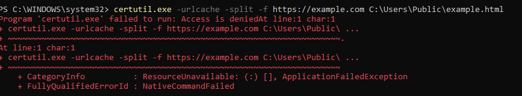
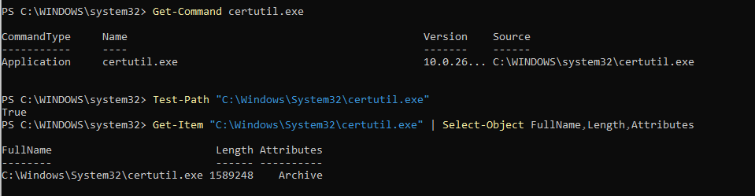
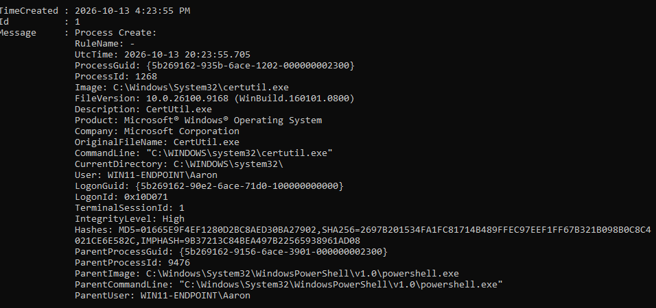

# Scenario 10 - Certutil Remote Download Attempt

## Objective

Evaluate detection of `certutil.exe` used for remote content retrieval.

## Data Source

- Intended source: Sysmon Event ID 1 - Process creation

## Experimental Rule

- **Rule ID:** `100107`
- **Severity Level:** `10`
- **MITRE ATT&CK:** `T1105` - Ingress Tool Transfer

## Test

Several benign remote retrieval attempts were made using `https://example.com`.

The endpoint returned:

```text
Access is denied
```

`certutil.exe` itself was available and could be executed without remote-retrieval arguments.

Sysmon confirmed process creation only for the plain `certutil.exe` execution, not for the blocked remote-download form.

## Result

 **The endpoint blocked the remote retrieval attempt before the expected Sysmon process telemetry was generated.**

The custom rule therefore could not be validated live and remained experimental.

## Detection Engineering Takeaway

Preventive controls can stop behavior before the telemetry expected by a detection rule is generated. This is a valid defensive outcome and should be documented rather than bypassed.

## Evidence







The evidence demonstrates that `certutil.exe` existed and executed normally, while the remote retrieval form was blocked with `Access is denied`. Sysmon Event ID `1` was observed for the normal execution, but not for the blocked command containing the remote-download arguments.
